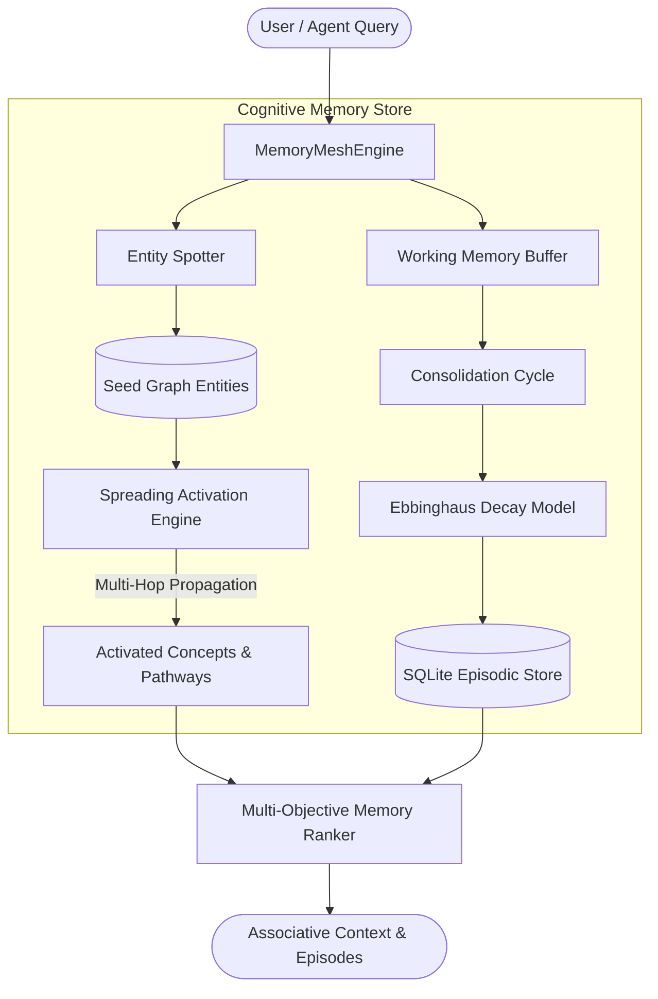

# Agentic Memory Mesh

[](https://opensource.org/licenses/MIT)
[](https://www.python.org/)
[](https://docs.pydantic.dev/)
[]()

**Agentic Memory Mesh** is a graph-augmented episodic and semantic long-term memory engine for autonomous LLM agents.

It replaces naive flat vector search with cognitive-inspired **Spreading Activation Retrieval**, **Entity-Relation Graph Linking**, and **Ebbinghaus Temporal Decay**.

---

## 📌 Architecture Overview



---

## 🚀 Key Innovations

### 1. Multi-Hop Spreading Activation Retrieval
Flat semantic retrieval only finds documents that share direct textual similarity. Memory Mesh propagates activation energy outward through relational graph edges:
$$\Delta E_{j} = E_{i} \cdot \alpha \cdot \frac{W_{ij}}{\sum_k W_{ik}}$$
This allows agents to associate distant concepts across multi-session horizons (e.g. *Minh* $\to$ *VLM* $\to$ *vLLM* $\to$ *Nvidia A100*).

### 2. Spaced-Repetition Ebbinghaus Forgetting Curve
Real biological cognition forgets ephemeral details while consolidating reinforced memories:
$$R(t) = \exp\left( -\frac{\Delta t}{S \cdot (1 + \ln(1 + \text{access\_count}))} \right)$$
* High-importance memories decay significantly slower.
* Each recall access reinforces the retention stability factor.

### 3. Native Zero-Bloat Persistence
* Lightweight, single-file SQLite database with JSON schema validation.
* No external vector DB server or container required.

---

## 📦 Installation

```bash
git clone https://github.com/nhminhhh/agentic-memory-mesh.git
cd agentic-memory-mesh
pip install -e .
```

---

## 💡 Quickstart Example

```python
from memory_mesh.engine import MemoryMeshEngine

# 1. Initialize engine
engine = MemoryMeshEngine(storage_path="agent_memory.db")

# 2. Ingest observations
engine.ingest(
    content="Alice leads AI research and optimizes PyTorch pipelines",
    importance=0.9,
    entities=["Alice", "PyTorch"],
    relations=[("Alice", "PyTorch", "OPTIMIZES")]
)
engine.ingest(
    content="PyTorch models run on Apple Silicon with MPS hardware acceleration",
    importance=0.8,
    entities=["PyTorch", "Apple Silicon", "MPS"],
    relations=[("PyTorch", "Apple Silicon", "RUNS_ON")]
)

# 3. Associative recall
result = engine.recall("What hardware accelerates tools used by Alice?", top_k=2)

print(f"Latency: {result.recall_latency_ms} ms")
for ep in result.episodes:
    print(f"- {ep.content}")
```

Run the interactive conversational simulation:
```bash
python examples/conversational_agent_memory.py
```

---

## 💻 Command Line Interface (CLI)

```bash
# Ingest an experience
memory-mesh ingest "Minh won first place in Zalo AI Challenge" --importance 0.9 --entities Minh "Zalo AI"

# Query associatively
memory-mesh recall "What competitions did Minh participate in?" --top-k 3

# View engine statistics
memory-mesh stats

# Run consolidation & decay pruning
memory-mesh consolidate
```

---

## 🧪 Running Tests

```bash
pytest tests/ -v
```

---

## 📄 License
This project is licensed under the MIT License - see the [LICENSE](LICENSE) file for details.
