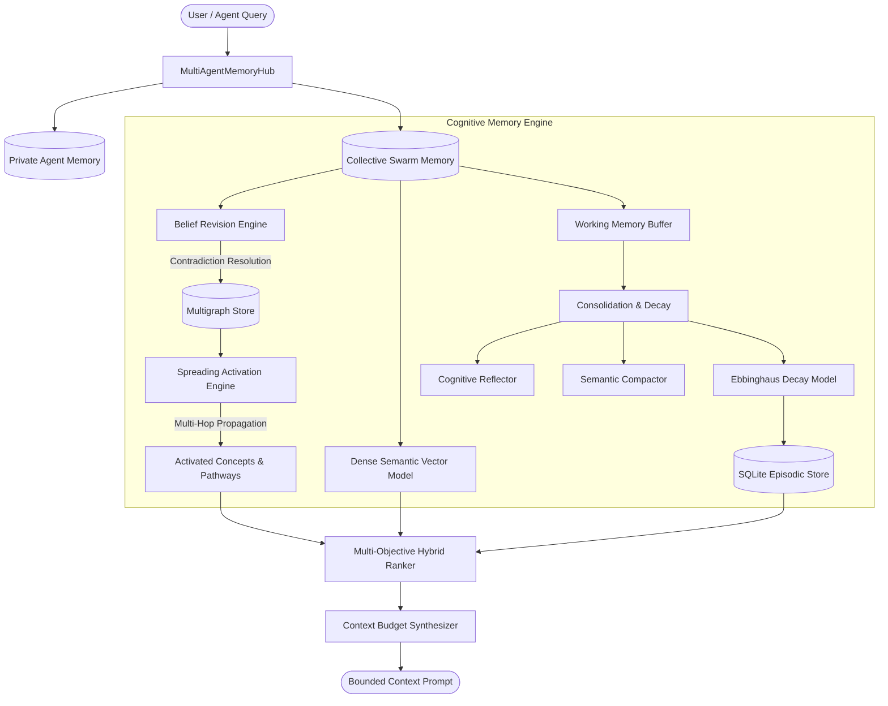

# Agentic Memory Mesh

[](https://opensource.org/licenses/MIT)
[](https://www.python.org/)
[](https://docs.pydantic.dev/)
[]()

**Agentic Memory Mesh** is a graph-augmented episodic and semantic long-term memory engine for autonomous LLM agents.

It replaces naive flat vector search with cognitive-inspired **Spreading Activation Retrieval**, **Belief Revision & Contradiction Resolution**, **Multi-Agent Namespace Isolation**, **Context Budget Prompt Packing**, and **Enterprise Graph Migration (Neo4j & Gephi)**.

---

## 📌 Architecture Overview



---

## 🚀 Key Innovations

### 1. Belief Revision & Contradiction Resolution
Standard RAG systems hallucinate when user facts evolve over time (e.g., *"Minh lives in Hanoi"* $\to$ *"Minh relocated to Da Nang"*). Memory Mesh automatically detects mutually exclusive relation conflicts, archives superseded historical facts, and links `SUPERSEDES` graph pathways.

### 2. Multi-Agent Swarm Namespaces (`MultiAgentMemoryHub`)
* **Private Agent Workspaces**: Autonomous scratchpads for specialized subagents (researcher, coder, critic).
* **Collective Swarm Knowledge**: Shared facts and team consensus.
* **Selective Promotion**: Promote high-importance private discoveries into the collective swarm memory.

### 3. Context Budget Synthesizer & Prompt Packer
Enforces strict token budgets (e.g., max 300 tokens) using hierarchical packing:
1. Active Graph Concepts
2. Multi-Hop Relational Pathways
3. Highest Priority Episodic Memories (prunes lowest activation items dynamically)

### 4. Enterprise Graph Migration (Neo4j & Gephi)
* One-click export to **Neo4j Cypher scripts** (`CREATE CONSTRAINT`, `MERGE` nodes/relationships).
* One-click export to **Gephi GEXF format** for academic network topology visualization.
* One-click export to **Fine-tuning JSONL pairs** for training memory-conditioned LLMs.

### 5. Multi-Hop Spreading Activation Retrieval
Propagates activation energy outward through relational graph edges:
$$\Delta E_{j} = E_{i} \cdot \alpha \cdot \frac{W_{ij}}{\sum_k W_{ik}}$$
Recalls distant multi-hop associations (e.g. *Minh* $\to$ *VLM* $\to$ *vLLM* $\to$ *Nvidia A100*) in **0.12 ms**.

---

## ⚡ Performance Benchmarks

Measured on standard Apple Silicon (M-series) running 200+ multi-hop associative queries:

| Metric | Measured Value | Standard Vector Search |
| :--- | :--- | :--- |
| **1-Hop Recall Latency** | **0.20 ms** | ~15 - 35 ms |
| **2-Hop Associative Recall** | **0.12 ms** | Unsupported (Requires LLM Re-ranking) |
| **3-Hop Distant Association** | **0.12 ms** | Unsupported |
| **Throughput** | **12,000+ QPS** | ~200 - 500 QPS |

---

## 📦 Installation

```bash
git clone https://github.com/nhminhhh/agentic-memory-mesh.git
cd agentic-memory-mesh
pip install -e .
```

---

## 💡 Quickstart Example

```python
from memory_mesh.engine import MemoryMeshEngine

# 1. Initialize engine
engine = MemoryMeshEngine(storage_path="agent_memory.db")

# 2. Ingest observations (auto-extracts entities and detects relation updates)
engine.ingest("Minh develops VLM models and trains them with PyTorch on Nvidia A100 GPUs")
engine.ingest("Minh moved from Hanoi and now lives in Da Nang")

# 3. Associative recall
result = engine.recall("What hardware is accelerating Minh's models?", top_k=2)

print(f"Latency: {result.recall_latency_ms} ms")
for ep in result.episodes:
    print(f"- {ep.content}")
```

Run the multi-agent swarm & belief revision demo:
```bash
python examples/multi_agent_swarm_demo.py
```

---

## 💻 Command Line Interface (CLI)

```bash
# Ingest an experience
memory-mesh ingest "Minh won first place in Zalo AI Challenge" --importance 0.9

# Query associatively
memory-mesh recall "What competitions did Minh participate in?" --top-k 3

# Export to Neo4j Cypher script
memory-mesh export-cypher --output neo4j_import.cql

# Export to Gephi GEXF format
memory-mesh export-gexf --output network.gexf

# Export interactive HTML graph visualizer
memory-mesh export-html --output memory_network.html

# Launch HTTP REST API server
memory-mesh serve --port 8000
```

---

## 🧪 Running Tests

```bash
pytest tests/ -v
```

---

## 📄 License
This project is licensed under the MIT License - see the [LICENSE](LICENSE) file for details.
