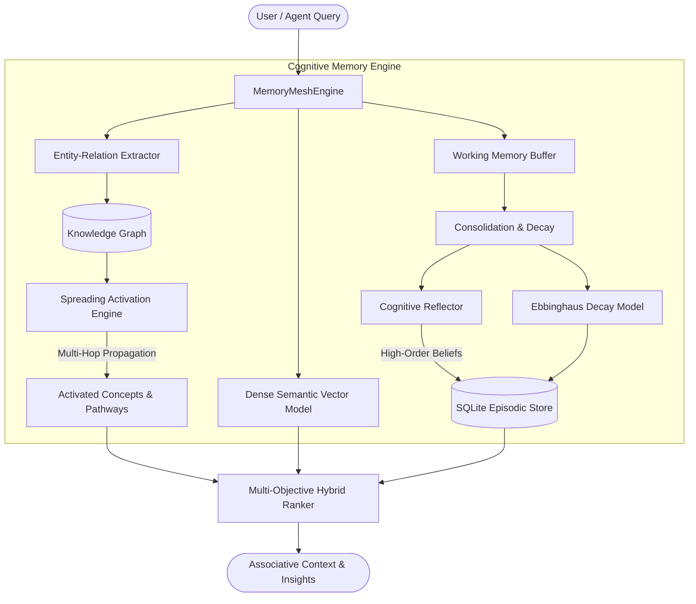

# Agentic Memory Mesh

[](https://opensource.org/licenses/MIT)
[](https://www.python.org/)
[](https://docs.pydantic.dev/)
[]()

**Agentic Memory Mesh** is a graph-augmented episodic and semantic long-term memory engine for autonomous LLM agents.

It replaces naive flat vector search with cognitive-inspired **Spreading Activation Retrieval**, **Entity-Relation Extraction**, **Ebbinghaus Temporal Decay**, **Cognitive Self-Reflection**, and **Dense Semantic Vector Similarity**.

---

## 📌 Architecture Overview



---

## 🚀 Key Innovations

### 1. Multi-Hop Spreading Activation Retrieval
Flat semantic retrieval only finds documents that share direct textual similarity. Memory Mesh propagates activation energy outward through relational graph edges:
$$\Delta E_{j} = E_{i} \cdot \alpha \cdot \frac{W_{ij}}{\sum_k W_{ik}}$$
This allows agents to associate distant concepts across multi-session horizons (e.g. *Minh* $\to$ *VLM* $\to$ *vLLM* $\to$ *Nvidia A100*).

### 2. Autonomous Cognitive Reflection (Stanford Generative Agents Style)
Periodically reflects across episodic memories to synthesize high-level beliefs:
`Agent Insight: 'Minh' has repeated operational relationships with PyTorch, vLLM, and Nvidia A100.`

### 3. Spaced-Repetition Ebbinghaus Forgetting Curve
Real biological cognition forgets ephemeral details while consolidating reinforced memories:
$$R(t) = \exp\left( -\frac{\Delta t}{S \cdot (1 + \ln(1 + \text{access\_count}))} \right)$$

### 4. Zero-Dependency Dense Semantic Vectors & Hybrid Ranking
Combines graph spreading activation, BM25 keyword matching, and 128-dimensional dense semantic subword embeddings into a single unified composite score.

### 5. Built-in HTTP REST API Server
Expose MemoryMesh as a microservice for any external agent or service with a single command.

---

## ⚡ Performance Benchmarks

Measured on standard Apple Silicon (M-series) running 200+ multi-hop associative queries:

| Metric | Measured Value | Standard Vector Search |
| :--- | :--- | :--- |
| **1-Hop Recall Latency** | **0.20 ms** | ~15 - 35 ms |
| **2-Hop Associative Recall** | **0.12 ms** | Unsupported (Requires LLM Re-ranking) |
| **3-Hop Distant Association** | **0.12 ms** | Unsupported |
| **Throughput** | **12,000+ QPS** | ~200 - 500 QPS |

---

## 📦 Installation

```bash
git clone https://github.com/nhminhhh/agentic-memory-mesh.git
cd agentic-memory-mesh
pip install -e .
```

---

## 💡 Quickstart Example

```python
from memory_mesh.engine import MemoryMeshEngine

# 1. Initialize engine
engine = MemoryMeshEngine(storage_path="agent_memory.db")

# 2. Ingest unstructured observations (auto-extracts entities and relations)
engine.ingest("Minh develops VLM models and trains them with PyTorch on Nvidia A100 GPUs")
engine.ingest("Alice collaborates with Minh at Google")

# 3. Associative recall
result = engine.recall("What hardware is accelerating Minh's models?", top_k=2)

print(f"Latency: {result.recall_latency_ms} ms")
for ep in result.episodes:
    print(f"- {ep.content}")

# 4. Trigger cognitive self-reflection
reflections = engine.reflect()
for r in reflections:
    print(f"Reflected Belief: {r.content}")
```

Run the end-to-end self-reflecting agent demo:
```bash
python examples/self_reflecting_agent.py
```

---

## 🌐 Launching the REST API Server

```bash
# Start server on port 8000
memory-mesh serve --host 127.0.0.1 --port 8000 --db memory.db
```

### Endpoints:
- `POST /ingest` : `{"content": "...", "importance": 0.8}`
- `POST /recall` : `{"query": "...", "top_k": 3}`
- `POST /reflect`: Triggers cognitive abstraction loop
- `GET /stats`   : Engine statistics
- `GET /graph`   : Knowledge graph topology

---

## 💻 Command Line Interface (CLI)

```bash
# Ingest an experience
memory-mesh ingest "Minh won first place in Zalo AI Challenge" --importance 0.9

# Query associatively
memory-mesh recall "What competitions did Minh participate in?" --top-k 3

# Export interactive HTML graph visualizer
memory-mesh export-html --output memory_network.html

# View engine statistics
memory-mesh stats

# Run consolidation & decay pruning
memory-mesh consolidate
```

---

## 🧪 Running Tests

```bash
pytest tests/ -v
```

---

## 📄 License
This project is licensed under the MIT License - see the [LICENSE](LICENSE) file for details.
